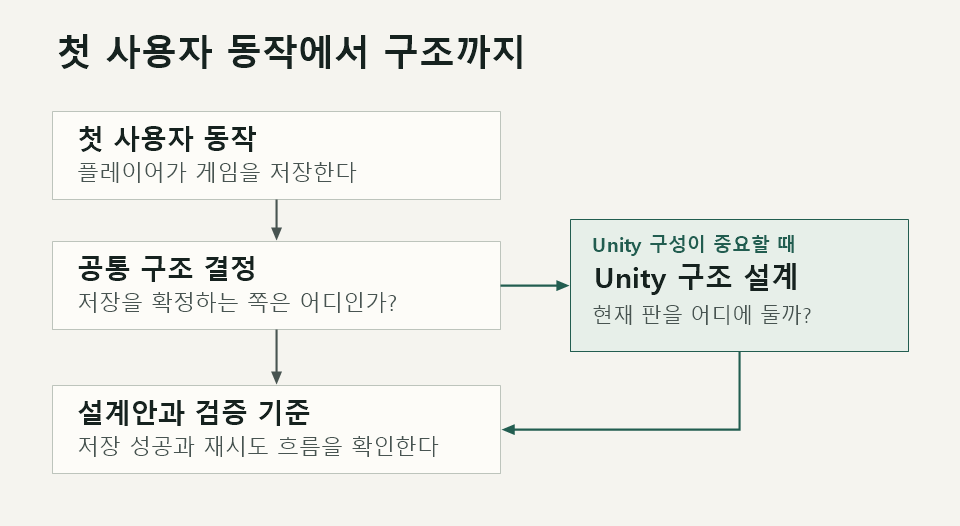

# software-architecture

[English](README.md)

소프트웨어를 어떤 구조로 만들지 정하는 Codex 스킬입니다. 사용자가 처음 완료할 동작을 하나 고르고 입력부터 결과까지 따라갑니다. 그 과정에서 각 판단을 누가 맡는지, 데이터를 어디에 두는지, 중간에 문제가 생기면 어떻게 처리할지 정합니다.

**[범용 스킬 다운로드](https://github.com/Ddrubok/software-architecture/releases/latest/download/software-architecture.zip)** 후 압축을 풀어 `software-architecture` 폴더를 `$CODEX_HOME/skills`에 넣으세요. 기본 위치는 `~/.codex/skills`입니다. 이것 하나로 시작하면 설계 중에 필요한 전문 스킬을 가져올 수 있습니다.



## 범용 스킬 하나로 시작하기

```text
$software-architecture Flutter 앱과 Rust API로 예약 기능을 설계해줘.
두 사람이 같은 시간대를 누르면 누가 예약을 확정하고, 각 화면에는 무엇이 보이는지 보여줘.
```

이 요청에서 Flutter 스킬은 응답을 기다리는 동안 화면이 보여줄 상태를 정하는 데 쓰입니다. Rust 스킬은 예약을 확정하거나 거절하는 쓰기 작업을 어디에 둘지 정하는 데 쓰입니다. 두 설계가 맞물리는 지점은 같은 시간대에 요청 두 건을 보냈을 때 예약이 한 건만 확정되는지로 검증할 수 있습니다.

Codex는 선택한 스킬이 이미 설치되어 있으면 그 사본을 읽습니다. 처음 쓰는 스킬이면 함께 제공된 Python 3 도우미가 지정된 GitHub 릴리스를 받고 SHA-256으로 파일이 일치하는지 확인한 뒤 스킬 폴더에 설치합니다. Codex가 그 파일을 바로 읽으므로 같은 요청에서 설계가 이어집니다. 오프라인으로 작업해 달라고 하면 설치된 자료로 진행합니다. 기술별 판단이 필요 없는 요청은 범용 스킬 하나로 처리합니다.

## 선택할 수 있는 전문 스킬

| 기술 | 이 스킬로 결정할 수 있는 것 |
| --- | --- |
| [Unity](https://github.com/Ddrubok/unity-game-architecture) | 씬을 바꿔도 이어져야 하는 한 판의 상태를 어디에 둘까? |
| [Godot](https://github.com/Ddrubok/godot-game-architecture) | 방을 나갔다 돌아올 때 어떤 상태를 유지할까? |
| [Unreal Engine](https://github.com/Ddrubok/unreal-game-architecture) | 누가 점수를 확정하고, 캐릭터가 부활하면 무엇을 유지할까? |
| [Flutter](https://github.com/Ddrubok/flutter-app-architecture) | 저장 버튼을 누르고 화면을 떠나면 진행 중인 작업은 누가 맡을까? |
| [Rust](https://github.com/Ddrubok/rust-software-architecture) | 어느 부분을 별도 crate로 만들고, 쓰기 실패는 어디서 처리할까? |

각 저장소에서 전문 스킬만 받을 수도 있습니다. 오프라인으로 쓸 컴퓨터에 Unity까지 미리 설치하려면 [범용 + Unity ZIP](https://github.com/Ddrubok/software-architecture/releases/latest/download/software-architecture-with-unity.zip)을 받으세요.

## 무엇을 받나요?

- 첫 사용자 동작에 필요한 구성 요소와 서로 정보를 주고받는 방식
- 어떤 구성 요소가 데이터를 바꿀 수 있는지, 그 데이터가 얼마나 오래 유지되는지에 대한 결정
- 정상 경로와 관련 실패 상황의 확인 기준, 구조를 다시 검토할 조건

구현까지 요청하면 Codex가 첫 사용자 흐름을 프로젝트에 연결하고 확인합니다. [스킬 지침](SKILL.md) · [전문 스킬 선택 및 설치 절차](references/domain-routing.md)
