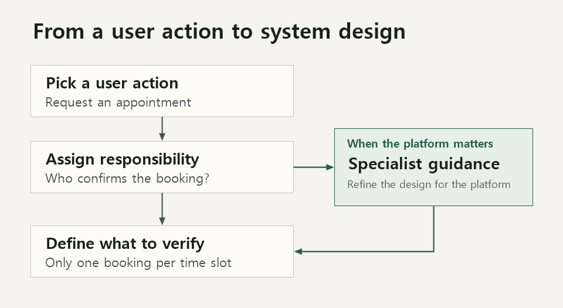

# software-architecture

[한국어](README.ko.md)

A Codex skill for deciding how a piece of software should be put together. Pick the first task a user needs to complete, then trace it from input to result. That makes it easier to see which part should make each decision, where data should live, and what happens if a step fails.

[Download the general skill](https://github.com/Ddrubok/software-architecture/releases/latest/download/software-architecture.zip) · [Download the general skill + Unity](https://github.com/Ddrubok/software-architecture/releases/latest/download/software-architecture-with-unity.zip)



## Try it

```text
$software-architecture Design the first working flow for an appointment booking app.
Show how a request becomes a confirmed booking and what happens if two people pick the same slot.
```

Start with someone choosing a time. If a slot can hold only one booking, decide which part of the system makes the final call. The screen shows that decision. One test sends two requests for the same slot and checks that exactly one is confirmed.

## What you get

- A map of the parts involved in the first user task and how they communicate
- A decision about which part can change each piece of data and how long that data is kept
- Checks for the normal flow and relevant failures, plus the conditions that would change the design

Ask for implementation as well, and the skill guides Codex to connect and verify that first flow in the project. If a platform constraint affects the design, it can use an installed specialist skill for that part. See the [specialist selection guide](references/domain-routing.md).

## Install

Download a ZIP above and extract it. Move the `software-architecture` folder into your Codex skills directory. For the Unity bundle, move `unity-game-architecture` into that same directory too, beside `software-architecture`.

The skills directory is `$CODEX_HOME/skills` if you have set `CODEX_HOME`. The default is `~/.codex/skills`.

[Skill instructions](SKILL.md)
